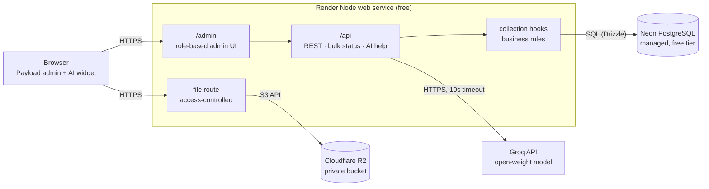

# Benrey Admin Take-Home — Architecture

> Generated on 2026-11-10 | Momento: **validate** — MVP / take-home submission, solo builder, no real users yet

## Summary

A single Node.js application built on Payload CMS 3 (Next.js App Router, TypeScript). Payload generates the admin UI from collection configs and provides auth, access control, uploads, and a REST/local API. Data lives in managed PostgreSQL (Neon). Uploaded files live in a private Cloudflare R2 bucket and are served through Payload's access-controlled file route. Two small custom admin components cover the bulk status action and the AI help widget. The domain is Support Ticket Tracker (see ADR-017).

## Alignment Score

```
Dimension extraction — 9/9 dimensions confident for a validate-stage take-home

  project_moment     validate   (0.95)  "take-home", "MVP-sized", "demo"
  product_type       web        (0.85)  "admin interface", "live URL"
  team_size          1          (0.95)  candidate builds alone
  user_scale         lt_1k      (0.80)  demo accounts only; seed data is for admin performance, not real traffic
  monthly_budget     free       (0.85)  brief: free-tier services "genuinely fine everywhere"
  needs_realtime     false      (0.85)  CRUD + admin, no live features
  access_pattern     balanced   (0.75)  admin CRUD with list filters and search
  has_offline        false      (0.90)  web app, always online
  latency_critical   false      (0.85)  admin/CRUD workload
  compliance         none       (—)     no regulated data in scope
  ai_complexity      simple     (—)     single LLM call grounded in field descriptions, no RAG
```

Stack alignment for a validate-stage take-home: every "Use Now" item fits this moment. Nothing from the scale tier is included.

## Architecture Diagram (ASCII)

```
   Browser
   (Payload admin + AI help widget)
          │  HTTPS
          ▼
 ┌──────────────────────────────────────────┐        ┌──────────────────────────┐
 │ Render Node web service (free)           │  SQL   │ Neon PostgreSQL (managed)│
 │  Next.js + Payload CMS                   ├───────▶│  free tier               │
 │   ├─ /admin  (role-based admin UI)       │        └──────────────────────────┘
 │   ├─ /api    (REST, bulk-status, AI)     │  S3 API┌──────────────────────────┐
 │   ├─ file route (access-controlled)      ├───────▶│ Cloudflare R2            │
 │   └─ collection hooks (business rules)   │        │  private bucket          │
 └──────────────────────────────────────────┘        └──────────────────────────┘
          │  HTTPS, key from env, 10s timeout
          ▼
 ┌──────────────────────────┐
 │ Groq API (free tier,     │
 │ open-weight LLM)         │
 └──────────────────────────┘
```

## Architecture Diagram (Mermaid)



## Use Now

### Payload CMS 3 (latest stable 3.x, pinned exact at scaffold time)
- **Role:** Admin UI, collections, auth, access control, uploads, REST and local API.
- **Why now:** The admin is generated from collection configs, which is the framework's own tooling and what the rubric rewards. Auth (hashed passwords, sessions), access functions, and upload collections are built in. Collection-level access hides collections the role cannot read, so role differences are visible in the UI.
- **When to replace:** Payload 4 reaches stable and has a migration guide that is worth the effort, or a non-admin public UI needs a different frontend. Stay on the 3.x line until then; 4.x is still a beta at the time of writing.

### Next.js (App Router) — bundled with Payload
- **Role:** Hosts `/admin` and `/api`, and serves built static assets.
- **Why now:** Payload 3 runs inside Next.js, so there is no separate server or static-file service to configure.
- **When to replace:** Not expected to change while Payload is in use.

### Node.js 24 LTS + pnpm + TypeScript (strict)
- **Role:** Runtime, package manager, and language.
- **Why now:** `create-payload-app` and Payload 3.x require Node `^22.23.4 || >=24.22.1`. The project uses Node 24 LTS (24.22.2 or later), which is inside that range and in active LTS. pnpm gives reproducible installs via a lockfile. TypeScript types flow from collection configs into the generated `payload-types.ts`.
- **When to replace:** Not expected to change.

### PostgreSQL on Neon (free tier) via `@payloadcms/db-postgres`
- **Role:** Managed relational database for all environments.
- **Why now:** Managed service, required by the brief, with a free tier and a standard connection string. The Postgres adapter uses Drizzle under the hood and produces committed, reviewable migrations. Same engine locally and in production.
- **When to replace:** Free compute hours run out, or p95 query time stays above 200 ms with proper indexes.

### Cloudflare R2 via `@payloadcms/storage-s3`
- **Role:** Object storage for the `media` upload collection. Bucket stays private.
- **Why now:** R2 is S3-compatible. Payload's docs recommend the S3 adapter for Node hosts, and the R2-specific adapter is for Cloudflare Workers only. Files never touch Render's ephemeral disk, and browsers upload straight to R2 (ADR-022).
- **When to replace:** Storage or egress passes the free tier.

### sharp
- **Role:** Image resizing for Payload's `imageSizes` (cover thumbnails).
- **Why now:** Payload uses it for image processing. Thumbnails keep list views fast with many records.
- **When to replace:** Not expected to change.

### Render (free Node web service)
- **Role:** Hosts the Next.js/Payload app, provides HTTPS and env-var secrets.
- **Why now:** Native Node builds (`pnpm install && pnpm build`, start with `pnpm start`), automatic HTTPS, and a free tier. Free instances sleep after 15 minutes of inactivity, which is accepted for this task.
- **When to replace:** Cold starts hurt reviewers. Upgrade to a paid instance (about $7/mo) rather than changing platform.

### Vitest
- **Role:** Unit tests for business logic (ticket status transitions, validation helpers).
- **Why now:** Runs TypeScript without a separate build step, and is fast enough for the rubric's "tests for the one piece of real business logic".
- **When to replace:** Not expected to change.

## Add Later

- **Groq API (open-weight Llama model) for the AI help chat** — add when: the core admin requirements (TASK.md sections 1–8) are complete and deployed. Not now because: the chat is a bonus, and it needs the field-description context built first. Free tier, no card required.
- **OAuth provider (GitHub) via a Payload-compatible auth plugin or custom strategy** — add when: all required admin features, both roles, and their tests are passing. Not now because: OAuth is a bonus, and the role model must be settled first. A new OAuth user starts with no roles and no admin panel access. An admin assigns a role (see ADR-021).

## Don't Use Now

- **Separate Express, Nest, or Fastify API** — Payload's REST and local API already cover the data layer. Reconsider when: a second client (mobile, public site) needs a different contract.
- **Custom SPA frontend or a second admin UI** — the Payload admin is the UI, extended only with two admin components. Reconsider when: ops users need workflows that admin components cannot express.
- **Redis, Celery, BullMQ, or any task queue** — no background work is in scope. The AI call is synchronous with a 10-second timeout. Reconsider when: any single request needs more than 10 seconds of work, such as large exports.
- **Docker / Docker Compose / Kubernetes** — Render builds Node directly, and local dev needs only Postgres and pnpm. Reconsider when: a system package must be installed at build time.
- **Payload 4.x beta** — not stable at the time of writing, and its config key for storage changed (`storage` instead of `plugins`). Reconsider when: 4.x is marked stable and the migration is straightforward.
- **`@payloadcms/storage-r2` (Workers binding)** — only for Cloudflare Workers, not Node hosting. Reconsider when: the app moves to Workers.
- **SLA timers, email notifications, or realtime updates** — need background jobs or websockets, which are deep-dive work outside this scope. Reconsider when: SLA or escalation rules become a requirement.
- **Elasticsearch, Meilisearch, or any dedicated search service** — `searchable` text fields with indexed columns are enough at seed scale. Reconsider when: search p95 exceeds 300 ms on the seeded dataset, then try PostgreSQL `pg_trgm` first.
- **SQLite in any environment** — the brief forbids a local database file in production, and one engine across environments avoids drift.

## Data Model

Domain: Support Ticket Tracker (ADR-017).

| Collection | Key fields | Relations | Notes |
|---|---|---|---|
| `users` (auth) | email, name, `roles` (select, hasMany: `admin`, `agent`) | — | Staff only. Passwords hashed by Payload. Customers are not users. |
| `customers` | name, email (unique), company | — | Ticket requesters. Admin and agent can create and edit; only admin can delete. |
| `tags` | name (unique), color | many-to-many with `tickets` | Managed by admin; agents read only. |
| `tickets` | subject (5–200 chars), description (rich text), status (select), priority (select: low, normal, high, urgent), dueAt (set on create from priority, see ADR-018), resolvedAt, closedAt | FK to `customers`, FK to `users` (assignee, nullable), many-to-many with `tags` | Status transitions in a hook. `isOverdue` is computed from `dueAt`, `status`, and the current time. |
| `comments` (array rows inside `tickets`) | body, attachments (hasMany `media`, max 5), author (FK to `users`, set by server), createdAt (set by server) | FK to `users`, many-to-many with `media` | Edited inline on the ticket. Replaces the separate collection (ADR-019). |
| `media` (upload) | file, alt | — | Stored in R2. Uploaded straight from the browser with a signed URL (ADR-022). MIME allowlist (images, PDF, plain text), 5 MB limit, magic-byte check. |

Status values: `new`, `in_progress`, `waiting_customer`, `resolved`, `closed`. Transitions are defined in one map (`src/lib/ticketStatus.ts`), see ADR-017.

Access by role:
- **admin:** full access to all collections, can delete tickets and customers, manages users and tags.
- **agent:** reads all tickets, creates and edits tickets and comments, changes status only through allowed transitions, creates and edits customers, cannot delete anything, cannot manage users or tags.

## Architecture Decision Records

### ADR-001: Django instead of Next.js or FastAPI
- **Choice:** Django 5.2 LTS as the single application framework.
- **Why:** The admin is the core deliverable, and Django's admin is the framework's own tooling. Auth, CSRF, sessions, and migrations come built in, so the security checklist is mostly configuration.
- **Tradeoff:** Server-rendered only, and the public-facing UI would be less flexible than a React frontend. Acceptable because the brief centers on the admin.
- **Revisit when:** A non-admin public UI or a mobile client is required.

### ADR-002: Use the Django admin as the admin UI (no custom SPA)
- **Choice:** ModelAdmin subclasses with `list_display`, `list_filter`, `search_fields`, inlines, custom actions, and `get_readonly_fields` / `has_*_permission` for role differences.
- **Why:** Meets the requirement with framework tooling, which the rubric rewards and hand-built admin UI penalizes.
- **Tradeoff:** Styling options are limited to templates and CSS overrides. Complex multi-step ops workflows would be awkward.
- **Revisit when:** Ops users need workflows beyond CRUD, filters, and bulk actions.

### ADR-003: Neon PostgreSQL as the managed database
- **Choice:** Neon free tier, one database for dev and production (separate branches for dev and production data).
- **Why:** Managed Postgres with a free tier and a standard connection string. Does not expire the way Render's free Postgres does.
- **Tradeoff:** Auto-suspended compute means the first query after idle adds a cold-start delay.
- **Revisit when:** Free compute hours are exhausted or query latency becomes the bottleneck.

### ADR-004: Private Cloudflare R2 bucket with presigned URLs
- **Choice:** Django `FileField`/`ImageField` backed by django-storages S3 backend pointed at R2. Bucket is private. Files are served via time-limited presigned URLs. Filenames are UUIDs generated on save.
- **Why:** Uploads survive redeploys, no public bucket exposure, and the code is S3-standard.
- **Tradeoff:** Presigned URLs expire, so links shown in admin must be generated on request rather than stored.
- **Revisit when:** Storage or egress exceeds the free tier, or public image delivery needs a CDN.
- **Status:** Superseded by ADR-011 (Node.js stack).

### ADR-005: Roles through Django Groups and model permissions
- **Choice:** Two groups created by a data migration or management command: **Admin** (add, change, delete, custom actions) and **Viewer** (view only, no actions). Enforcement lives in ModelAdmin `has_add_permission`, `has_change_permission`, `has_delete_permission`, `get_actions`, and `get_readonly_fields`.
- **Why:** Django already checks these on every request, so the restriction is enforced server-side, and the restricted UI is a consequence of the same checks.
- **Tradeoff:** Permissions must be kept in sync across models. A test per role keeps them honest.
- **Revisit when:** Row-level permissions are needed (then consider django-guardian).
- **Status:** Superseded by ADR-012 (Node.js stack).

### ADR-006: WhiteNoise for static files
- **Choice:** WhiteNoise middleware with `collectstatic` during the build.
- **Why:** Static files work in production with no extra service.
- **Tradeoff:** Static traffic shares the web service.
- **Revisit when:** Static traffic slows the app.
- **Status:** Superseded by ADR-015 (Node.js stack).

### ADR-007: Synchronous AI help call with a timeout and graceful failure
- **Choice:** One POST endpoint in the admin. The view builds a prompt from the model's field metadata (verbose_name, help_text, choices), caps user input at 500 characters, calls the model with a 10-second timeout, and returns a friendly message on any error.
- **Why:** A single call does not justify a queue. A failure must never take down the admin.
- **Tradeoff:** A slow model blocks one request until the timeout. Acceptable at demo traffic.
- **Revisit when:** Timeouts are frequent, or streaming responses are needed.

### ADR-008: Render for hosting, Neon and R2 for managed services
- **Choice:** Render web service plus Neon plus R2, all on free tiers.
- **Why:** Lowest setup cost that still satisfies "real managed DB" and "real object storage" from the brief.
- **Tradeoff:** Three vendors instead of one, and free-tier cold starts.
- **Revisit when:** Cold starts hurt the review experience, which means upgrading the Render instance.

### ADR-009: Payload CMS 3 instead of Django
- **Choice:** Payload CMS 3 (stable 3.x line) on Next.js App Router with TypeScript. Supersedes ADR-001 and ADR-002.
- **Why:** The admin is generated from TypeScript collection configs, which is what the brief asks for ("generated by a framework's or CMS's built-in admin tooling"). Auth, access control, uploads, and a REST API come in one package, so the stack stays small.
- **Tradeoff:** Next.js is a heavier dependency than a plain API server, and custom admin behavior requires React components. Accepted because the admin is the core deliverable.
- **Revisit when:** Payload 4 is stable and worth migrating to, or the admin cannot express a required workflow.

### ADR-010: Payload admin as the admin UI, extended with two custom components
- **Choice:** The default Payload admin, with `admin.components` for (1) a bulk status change action in the Loans list view and (2) the AI help widget. Supersedes ADR-002.
- **Why:** Filters, search, relationship fields, and array fields come from Payload's admin. Only the two behaviors Payload does not provide are custom code.
- **Tradeoff:** The bulk action is a custom component plus a custom endpoint, so it must re-check roles on the server, not just hide the button.
- **Revisit when:** Ops users need more than bulk status change.

### ADR-011: Private R2 bucket served through Payload's access-controlled file route
- **Choice:** `@payloadcms/storage-s3` pointed at R2 with `region: 'auto'` and the account endpoint. Files are not public. Downloads go through Payload's file route, which applies the `media` collection's read access. Supersedes ADR-004.
- **Why:** Read access to a file follows the same role rules as the record it belongs to, with no separate presigned-URL logic. The bucket never needs public access.
- **Tradeoff:** File bytes pass through the web service, which costs bandwidth and time on the free instance. Acceptable at demo volume.
- **Revisit when:** Image bandwidth becomes a bottleneck. Then switch to public-read objects behind a CDN with `disablePayloadAccessControl`.

### ADR-012: Roles through a `roles` field and collection access functions
- **Choice:** `users.roles` (select, hasMany: `admin`, `viewer`). Each collection defines `access` functions. Admin: full access. Viewer: read-only on domain collections; `users` and other admin-only collections are not readable, so they disappear from the admin nav. Supersedes ADR-005.
- **Why:** Access checks run on every REST and local API call, so the restriction holds even if the UI is bypassed. Hiding collections happens as a result of the same rule.
- **Tradeoff:** Access functions repeat across collections. A shared helper (`isAdmin`, `canRead`) keeps them consistent. A test per role keeps them honest.
- **Revisit when:** Row-level permissions are needed (for example, each agent sees only their own tickets).

### ADR-013: PostgreSQL through `@payloadcms/db-postgres` with committed migrations
- **Choice:** Postgres adapter (Drizzle). Schema changes are made with `payload migrate:create` and committed. Production runs `payload migrate`, never `push`. Extends ADR-003.
- **Why:** Migrations are reviewable in git, and production schema changes are explicit.
- **Tradeoff:** Each schema change needs a migration file, which adds steps during development.
- **Revisit when:** Not expected to change.

### ADR-014: Business logic in collection hooks, with pure functions tested in isolation
- **Choice:** Loan status transitions live in a pure function (`src/lib/loanStatus.ts`) that is called from the `loans` collection's `beforeChange` hook. The function is covered by Vitest. Overdue status is derived from `dueAt` and `returnedAt`, not stored as a separate write.
- **Why:** The rule is testable without a database, and the hook keeps it enforced for every write path, including the API and the admin.
- **Tradeoff:** Two layers (function plus hook) for one rule. Small cost for testability.
- **Revisit when:** More rules appear and need a shared service layer.

### ADR-015: Static assets served by Next.js, no separate static service
- **Choice:** Next.js serves its own built assets, including Payload admin assets. Supersedes ADR-006.
- **Why:** Payload 3 is a Next.js app, so static serving is built in.
- **Tradeoff:** Static assets share the web service. Acceptable at demo traffic.
- **Revisit when:** Static traffic slows the app.

### ADR-016: AI help widget as an admin component calling a custom endpoint
- **Choice:** A custom admin component on each collection's edit view opens a help panel. It posts to a custom endpoint, which builds the prompt from the collection's field configuration (`label`, `admin.description`, select options) and the user's question. The endpoint caps input at 500 characters, sends no database records, and uses a 10-second timeout. Failures return a friendly message. Applies ADR-007 in the Node stack.
- **Why:** Field descriptions are the real context the brief asks for, and nothing from user records is sent to the model.
- **Tradeoff:** The prompt is generated from config rather than hand-written text, so field descriptions must be written carefully.
- **Revisit when:** Timeouts become frequent, or streaming is needed.

### ADR-017: Domain — Support Ticket Tracker
- **Choice:** Support Ticket Tracker. Collections: `users`, `customers`, `tags`, `tickets`, `comments`, `media`. Roles: `admin` and `agent`.
- **Why:** The status workflow gives a real business rule that is easy to test. Bulk status change is a natural admin action. Comment attachments exercise uploads beyond a single cover image. The two roles have clear boundaries. The domain needs no concurrency control, background jobs, or realtime updates, so it stays off deep technical ground.
- **Name mapping for earlier ADRs:** ADR-010 "Loans list view" means the Tickets list view. ADR-014 `loans` and `loanStatus.ts` mean `tickets` and `ticketStatus.ts`. ADR-012 role `viewer` is replaced by `agent`. This is not a read-only role: agents create and edit tickets and customers, and only admins delete or manage users. The access mechanism in ADR-012 still applies.
- **Status transitions** (`src/lib/ticketStatus.ts`):
  - `new` → `in_progress`, `closed`
  - `in_progress` → `waiting_customer`, `resolved`
  - `waiting_customer` → `in_progress`, `resolved`
  - `resolved` → `in_progress` (reopen), `closed`
  - `closed` → none (terminal)
- **Guards:** moving to `in_progress` requires an assignee. Entering `resolved` sets `resolvedAt`. Entering `closed` sets `closedAt`.
- **Bulk status change:** runs the same transition check per ticket. Invalid transitions are reported per ticket, and the valid ones still apply.
- **Tradeoff:** A state machine is more code than plain CRUD. The rule set is small, so that cost stays low.
- **Revisit when:** SLA timers, escalation, or email notifications are required. Then background jobs become worth considering.

### ADR-018: Open decisions resolved before scaffolding
- **Runtime:** Node.js 24 LTS (24.22.2 or later). Node 22.14, which was installed locally, is below the minimum for Payload 3.x, so it is not used.
- **Local development:** Neon dev branch (one engine for dev and production, no local Docker database). Docker is not used for the app or the database.
- **Commits and push:** one commit per milestone (scaffold, models, roles, admin, seed, tests, deploy). Commits stay local until the project is complete, then push to `origin/main` in one step. The existing `init commit` on `origin/main` is kept as the base.
- **Bonuses:** AI help chat is in scope, built after the core admin passes (ADR-016). GitHub OAuth is deferred. Its approach will be decided later, so it stays in Add Later until then.
- **Ticket number:** no custom number field. The admin shows the Payload `id`, which is enough for demo purposes.
- **Due date rule:** `dueAt` is set automatically on create from priority: urgent 4 h, high 24 h, normal 72 h, low 168 h. A ticket is overdue when `now > dueAt` and its status is neither `resolved` nor `closed`. Computed in code, with no background job.
- **Seed data:** about 8 agents and 1 admin, 2,000 customers, 30 tags, 2,000 tickets, about 5,000 comments, and about 100 small attachments in R2. Seed reads account passwords from environment variables. No default password is stored in code.
- **Upload types:** JPEG, PNG, WebP, PDF, and plain text. 5 MB per file.
- **Package manager:** pnpm 10. Payload is pinned to the latest stable 3.x at scaffold time and the exact version is recorded in the lockfile.

### ADR-019: Comments as inline rows on tickets
- **Choice:** Comments are an array field on `tickets`. Each row has `body`, `attachments` (hasMany `media`, max 5), and server-set `author` and `createdAt`. This replaces the `comments` collection named in ADR-017.
- **Why:** Payload array rows are the framework's native inline editing, which the brief asks for. Attachments stay on the row. There is one collection fewer to manage.
- **Enforcement:** The `beforeChange` hook on `tickets` keeps the existing author and timestamp for rows that already exist, and sets the current user and time for new rows. A client cannot spoof authorship.
- **Tradeoff:** Comments have no separate access rules. Anyone who can edit a ticket can also edit or remove its comments.
- **Revisit when:** Comments need per-author edit rights, or need to be queried across tickets.

### ADR-020: Upload validation enforced on the server
- **Choice:** The `media` collection has a `beforeOperation` hook that rejects any MIME type outside the allowlist (JPEG, PNG, WebP, PDF, plain text) and any file over 5 MB. `upload.pasteURL` is `false`, so the server never fetches files from a remote URL. Reads go through Payload's access-controlled file route (ADR-011).
- **Why:** The `mimeTypes` option in Payload only filters the file picker in the browser. The server hook is the real check, and it runs on every write path.
- **Limitation:** The MIME type comes from the client's upload header. Content sniffing (checking magic bytes) is not implemented. Add it with a small library when time allows.
- **Revisit when:** Untrusted users can upload files, or an uploaded file type can execute.

### ADR-021: Security hardening: CSRF allowlist, staff-only admin, no default role, server-side file names
- **Choice:**
  - `serverURL` and `csrf` are set explicitly from `PAYLOAD_PUBLIC_SERVER_URL`. Payload then rejects cookie-authenticated requests whose `Origin` is not the app's own origin.
  - `users.access.admin` allows only staff roles. A user with no roles cannot open the admin panel.
  - `users.roles` has no default. New accounts have no access until an admin assigns a role.
  - Uploads are stored under a random UUID name with an extension taken from the validated MIME type. The original name is kept in a read-only `originalName` field.
- **Why:** Payload's default CSRF allowlist is empty, which disables the origin check. A default role would give any future self-registered account access. Client-chosen file names can collide or carry path tricks.
- **Verified against:** Payload 3.93.0 source (`csrf` handling in `extractJWT`, `serverURL` pushed into `csrf` in sanitize, cookie `SameSite=Lax` default).
- **Tradeoff:** Deploys must set `PAYLOAD_PUBLIC_SERVER_URL`. Startup fails without it. Existing seed media keeps the names it was created with until the next reset.
- **Revisit when:** Multiple front-end origins need cookie access (then extend the allowlist deliberately).

### ADR-022: Direct browser uploads to R2 through Payload's clientUploads
- **Choice:** The `s3Storage` plugin's `clientUploads` option. Staff request a signed PUT URL from `/api/storage-s3-generate-signed-url`. The URL is refused for sizes over 5 MB. The browser uploads straight to the private R2 bucket, then creates the `media` document with the signed receipt. `requiresClientUploadReceipt: true` on `media` refuses a document without a receipt. The `beforeOperation` hook validates the stored bytes (MIME, size, extension, magic bytes) and deletes the upload folder from R2 when a check fails. Storage keys are `<random UUID folder>/<sanitized client file name>`. This supersedes the UUID file-name rule in ADR-020 and ADR-021, and resolves the magic-byte limitation noted in ADR-020.
- **Why:** The brief asks for uploads that go straight to R2 without passing through the server. Payload's built-in flow does this and avoids a custom signing endpoint.
- **Tradeoff:** The file's own name (sanitized) is part of the key, so the UUID rule is relaxed. A new folder per upload keeps names from colliding. The signed URL checks only size and headers, so the server still reads each file from R2 once to check its content and make thumbnails. The R2 bucket's CORS list must include each app origin, including the Render URL before the first deploy.
- **Verified against:** `@payloadcms/storage-s3` 3.93.0 source (signing endpoint, `resolveSignedURLKey`) and Payload core `addDataAndFileToRequest` (receipt requirement). A live script run against the dev server passed 15 of 15 checks.
- **Revisit when:** Untrusted users can upload, or a served file type can run code. Then re-encode images and check the whole file, not only its first bytes.

## Cost Estimate

- **Monthly now:** $0 (Render free, Neon free, R2 free tier, Groq free tier when added)
- **Monthly at next stage:** about $7 (Render paid instance to remove sleep). Everything else stays on free tiers at demo volume.

### Cost Traps
- **Render free instances sleep** after 15 minutes idle. The first request can take 30–60 seconds, which looks like a broken deploy to a reviewer. Hit the URL once before sharing it.
- **Neon free storage is 0.5 GB.** Seed data must stay small: text-heavy rows are fine, but do not store large images in the database.
- **R2 free tier is 10 GB.** Seed images should be small (under about 100 KB each, a few hundred total).
- **File downloads pass through the web service** (ADR-011). Large downloads use the free instance's bandwidth and time. Uploads go straight to R2 (ADR-022), but the server still reads each file once to validate it. Keep upload size limits strict.
- **Unbounded AI chat use** can exhaust the Groq free quota and produce 429 errors. Add a per-user request cap (for example, 20 messages per hour), stored in the database or in memory on the single instance.
- **Uploads without size limits** fill storage quickly. Enforce a 5 MB limit on the `media` collection.

## Agent Rules

- DO NOT add Redis, BullMQ, Celery, or any task queue or background worker. The AI call is synchronous with a 10-second timeout.
- DO NOT add a SQLite fallback or any other local database. Every environment MUST use PostgreSQL via `DATABASE_URL`.
- DO NOT hardcode `PAYLOAD_SECRET`, `DATABASE_URL`, R2 credentials, or the AI API key. Read all of them from environment variables. Startup MUST fail if a required variable is missing in production.
- DO NOT commit `.env` or any real secret. `.env.example` MUST contain placeholder values only.
- DO NOT store uploaded files on local disk in production. Use `@payloadcms/storage-s3` pointed at R2. The bucket MUST be private.
- DO NOT use `@payloadcms/storage-r2`. This app runs on Node, not Cloudflare Workers.
- DO NOT serve uploaded files by public URL. Files MUST be read through Payload's file route so access control applies.
- DO NOT build a separate Express, Nest, or Fastify API. Use Payload's REST and local API, and Next.js route handlers only for custom endpoints.
- DO NOT build a separate SPA or a second admin UI. Extend the Payload admin only through `admin.components`.
- DO NOT put business rules in React components or route handlers. Status transitions and validation MUST live in collection hooks or pure functions in `src/lib/` that hooks call.
- Role restrictions MUST be enforced in collection `access` functions. A hidden button or hidden collection is not a restriction on its own.
- The bulk status endpoint and the AI endpoint MUST check the caller's role on the server, not only in the component.
- Schema changes MUST be made with `payload migrate:create` and committed. Production MUST run `payload migrate`. DO NOT use `push` in production.
- Every upload MUST be validated on the server: MIME allowlist on the `media` collection, 5 MB size limit, a file signature (magic bytes) that matches the MIME type, and an extension that matches the MIME type. Browsers upload straight to R2 through `clientUploads` (staff only), and the server MUST create the `media` document only with a receipt it signed (ADR-022). Storage keys are a random UUID folder plus the sanitized client file name. The original name goes to `originalName`.
- The AI endpoint MUST send only field metadata (label, admin.description, select options) and the user's question to the model. DO NOT send database records or other users' data.
- The AI endpoint MUST cap user input at 500 characters and MUST return a friendly error on timeout or API failure. DO NOT let an AI failure break the admin.
- Seed data MUST be created by the `pnpm seed` script (a TypeScript script using Payload's local API). DO NOT load demo data in migrations.
- Ticket status transitions MUST be defined only in `src/lib/ticketStatus.ts`. The `tickets` hook and the bulk status endpoint MUST both call that module. DO NOT duplicate the transition map anywhere else.
- The bulk status endpoint MUST apply the same transition and guard checks per ticket, and MUST report invalid transitions instead of failing the whole batch.
- Every status transition and validation rule MUST have a Vitest test.

## Changelog

| Date | Reason | Changes |
|------|--------|---------|
| 2026-11-10 | Initial generation | Django stack (ADR-001 to ADR-008) |
| 2026-11-10 | Stack change: Django replaced by Payload CMS 3 on Node.js | Rewrote Use Now, Add Later, Don't Use Now, diagrams, data model, cost traps, agent rules. Appended ADR-009 to ADR-016. ADR-001 to ADR-008 decision text unchanged; a Status line was added to ADR-004, ADR-005, and ADR-006 pointing to their replacements. ADR-001 and ADR-002 are superseded by ADR-009 and ADR-010 (see those entries). |
| 2026-11-10 | Review pass: security and consistency fixes | Explicit CSRF allowlist via PAYLOAD_PUBLIC_SERVER_URL, staff-only admin access, no default role, UUID file names with originalName (ADR-021). Clarified that the `viewer` to `agent` mapping is not read-only. Fixed OAuth default-role note. |
| 2026-11-10 | Scaffold implemented (Payload 3.93.0, Node 24.22.2) | Comments moved to inline rows on tickets (ADR-019). Upload validation on the server (ADR-020). Bulk status endpoint at `/api/tickets/bulk-status`. Unit tests for status workflow, due dates, and roles. |
| 2026-11-10 | Open decisions resolved before scaffolding | Node 24 LTS (was 22). Neon dev branch for local DB. Per-milestone local commits, push at end. AI chat in scope, OAuth deferred. Ticket number field dropped. dueAt rule and seed rules fixed. Added ADR-018. |
| 2026-11-10 | Domain chosen: Support Ticket Tracker | Replaced the Book Lending example in Data Model with tickets, customers, tags, comments, media, and users. Added role access matrix. Appended ADR-017 with status transitions and name mapping. Added Don't Use Now entry for SLA and notifications. Added transition rules to Agent Rules. |
| 2026-11-10 | Direct uploads to R2 | Browsers upload through Payload `clientUploads` with signed URLs (ADR-022). Storage keys are now `<uuid folder>/<client name>`, which replaces the UUID file-name rule in ADR-020 and ADR-021. Magic-byte and extension checks added, resolving the ADR-020 limitation. Updated Data Model, Use Now (R2), Cost Traps, and Agent Rules. |

---
To update, run `/planfirst` again.
